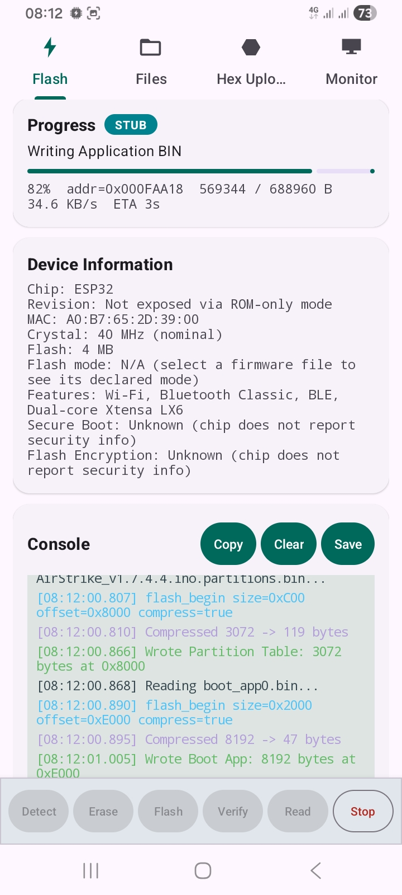
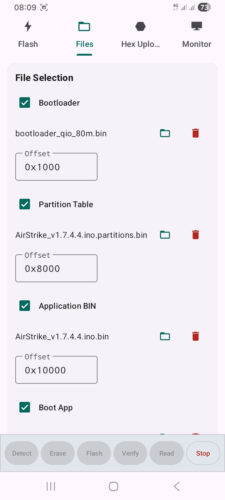
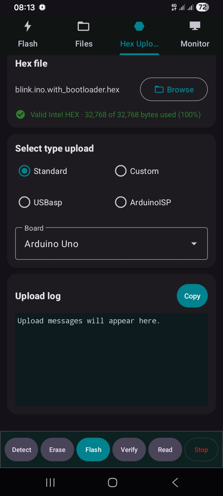
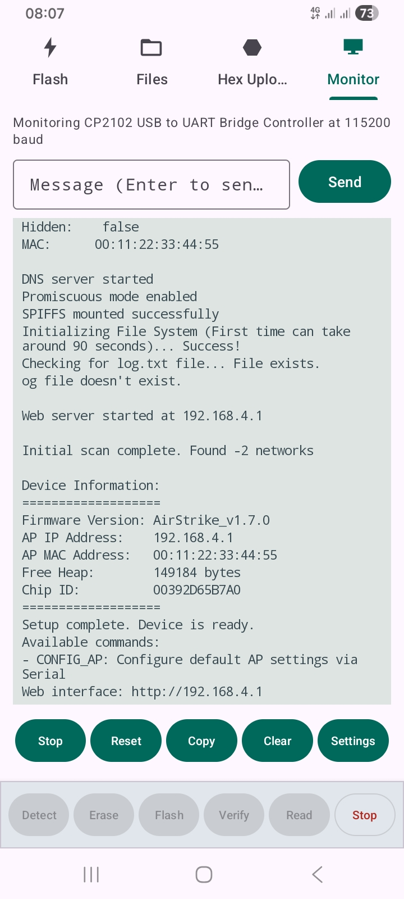

<div align="center">

# ESP Native Flasher

**Flash ESP32, ESP8266, BW16 and Arduino boards straight from your Android phone - no PC, no Python, no esptool.**

[](https://github.com/ELECTRO-GAMMA/ESP-Native-Flasher/releases/latest)
[](https://github.com/ELECTRO-GAMMA/ESP-Native-Flasher/releases)


[](LICENSE)

</div>

ESP Native Flasher is a native Kotlin Android app that talks to your board over **USB OTG**. The ESP serial bootloader protocol and the USB-UART bridge drivers are implemented inside the app. Nothing is shelled out, there is no embedded Python and no bundled esptool.

---

## Table of contents

- [Screenshots](#screenshots)
- [Why this project](#why-this-project)
- [Where you can use it](#where-you-can-use-it)
- [Features](#features)
- [Not supported](#not-supported)
- [Requirements and supported hardware](#requirements-and-supported-hardware)
- [Wiring, voltage and safety](#wiring-voltage-and-safety)
- [Quick start](#quick-start)
- [Step-by-step guides](#step-by-step-guides)
- [Troubleshooting](#troubleshooting)
- [Build from source](#build-from-source)
- [Project structure](#project-structure)
- [Permissions and configuration](#permissions-and-configuration)
- [Project information](#project-information)
- [Credits and third-party software](#credits-and-third-party-software)
- [License](#license)

---

## Screenshots

<!--
  Screenshot files are loaded from the docs/ folder. Add PNG files with these exact names and they appear here automatically:
  docs/screenshot-flash.png, docs/screenshot-files.png, docs/screenshot-hex-uploader.png,
  docs/screenshot-monitor.png, docs/screenshot-monitor-settings.png, docs/screenshot-settings.png
-->

### Flashing ESP chips

| Flash tab | Files tab |
|:---:|:---:|
|  |  |

### Arduino upload and serial monitor

| Hex Uploader tab | Monitor tab |
|:---:|:---:|:---:|
|  |  | 


---

## Why this project

Flashing a microcontroller normally means a laptop, a Python install, the right drivers and a terminal. That is awkward when you are in the field, at a customer site, or only own a phone.

| Problem | What this app does |
|---|---|
| You need a PC and Python just to flash a firmware `.bin` | Flashes directly from the phone over a USB OTG cable |
| Different boards need different tools (esptool, Ambd tool, avrdude, Arduino IDE) | One app with an ESP mode, a BW16 mode, a SIM800 mode and a Hex Uploader tab for AVR boards |
| Driver installation for CP210x / CH340 / FTDI / PL2303 | The bridge drivers are built in, and the app can start when a known adapter is plugged in |
| You want to watch the board's serial output right after flashing | Built-in serial monitor (baud, line ending, timestamps, send box) |
| Baking Wi-Fi credentials into a pre-built firmware | Optional patching of fixed-size `$your_..._maximum_32_characters` placeholders before flashing |
| Cloud tools or accounts | The app's manifest declares **no `INTERNET` permission**, and the code contains no network access |

## Where you can use it

| Situation | Typical device | How |
|---|---|---|
| Flash a ready-made firmware on an ESP32 / ESP8266 dev board | Phone + OTG cable + the board's USB port | Flash tab |
| Recover or back up a board away from your desk | Phone + OTG + USB-UART adapter | Flash tab (Detect / Read / Erase / Flash) |
| Update a device in the field | Phone + OTG + the device's UART header | Flash tab |
| Program a bare ESP module on a breadboard | Phone + OTG + USB-UART adapter (see [wiring](#wiring-voltage-and-safety)) | Flash tab + Boot button |
| Flash a BW16 (Realtek AmebaD) module | Phone + OTG + USB-UART adapter | Device mode: BW16 |
| Upload a compiled `.hex` to an Arduino | Phone + OTG + Uno / Nano / Mega / Leonardo / Micro, ... | Hex Uploader tab |
| Program an AVR with USBasp or an Arduino running ArduinoISP | Phone + OTG + programmer | Hex Uploader tab |
| Watch UART logs | Any board with a USB-UART bridge | Monitor tab |

## Features

**ESP chips (Flash tab, Device mode "Auto")**
- Connect, then **Detect**: chip type, MAC address, flash ID and size, chip features, and secure-boot and flash-encryption status where the chip reports it.
- **Flash** several images at their offsets (bootloader, partition table, OTA data, application, plus extra files), with optional zlib compression, **Verify** (MD5), erase-before-write, reset-after-flash and skip-checksum options.
- **Erase** the whole flash chip, or (ESP32 family) only the application and partition table.
- **Read flash to a file** with offset, length and flash-size presets from 500 KB to 64 MB.
- **StubLoader** option (on by default): uploads Espressif's flasher stub for faster transfers and for operations the ROM bootloader cannot do. With the option off, or when no stub exists for the chip, the app runs ROM-only.
- Configurable upload baud rate (default 921600). Switching Device mode to BW16 sets it to 1500000.
- **Boot** and **Reset** buttons (DTR/RTS), **Keep USB connection** option, and **Stop** to cancel a running operation.
- **Partition table**: load a partition-table file to read its entries; **Detect** in the SPIFFS row reads the table from the chip.
- **SPIFFS**: build a SPIFFS image from a folder on the phone (**SPIFFS**), download the files from the device's SPIFFS partition into a folder (**GET**), or **Erase** just that partition.
- **Firmware credentials**: patch Wi-Fi SSID, Wi-Fi password, token and OTA password into matching 32-byte placeholders of a firmware before flashing. A placeholder that is not present is left alone.
- Console with copy, clear and save, plus optional automatic log saving.
- Foreground service and notification so a running operation continues while the app is in the background.

**BW16 (Realtek AmebaD)** - flash and erase through the bundled flashloader, with a selectable upload baud rate, and Reset.

**Arduino / AVR (Hex Uploader tab)**
- *Standard* and *Custom* modes for boards with a bootloader: STK500v1, STK500v2 and AVR109, with 25 board presets. Upload only.
- *USBasp* (raw USB) and *ArduinoISP* modes: Flash, Verify and Read, with a memory-type selector (Flash, EEPROM, signature, calibration, lock and fuse bytes).
- Intel HEX parsing is built in.

**Serial monitor (Monitor tab)** - Start/Stop, Reset, Copy and Clear buttons; Settings for baud rate (300 to 2,000,000), line ending, autoscroll and timestamps; a message box with Send. It uses the connected port if there is one, otherwise it opens the selected USB device itself, and it stops automatically before any flash, erase or connect operation.

**SIM800 (SIMCom GSM module)** - ROM download through the module's boot protocol, with an optional FAT-format step. The app also contains "Rebrand ROM" and "Change IMEI" tools; see the [legal note](#sim800-brief-and-legal-note).

**App** - system, light or dark theme, default baud rate, auto-reconnect to the last device, console font size, and a crash screen that shows the error and stack trace.

## Not supported

- **iOS** and desktop operating systems: this is an Android app.
- **Wireless flashing** (Wi-Fi OTA, Bluetooth): the app only talks over USB.
- Phones **without USB host (OTG) support**.
- eFuse burning, secure-boot and flash-encryption key management, ELF-to-image conversion and image merging. The app reads security status but does not provision anything.
- **Reading flash back with the stub off** on any chip except classic ESP32 (the other ROMs have no flash-read command).
- **Verify on ESP8266 with the stub off**: the ESP8266 ROM has no MD5 command, so the app skips the check for that file and logs it.
- **Verify and Read in the Hex Uploader's Standard and Custom modes**: these modes upload only; use USBasp or ArduinoISP for Verify and Read.
- Microcontroller families other than AVR in the Hex Uploader (no ARM, STM32, RP2040, ...).
- USB-serial adapters that do not use CDC-ACM, CP210x, CH340/CH341, FTDI or PL2303 protocols.
- SIM800 mode cannot enter the boot ROM by itself: power-cycle or reset the module when the console asks.

## Requirements and supported hardware

**Phone:** Android 8.0 (API 26) or newer with USB host (OTG) support, and a data-capable USB-C or micro-USB OTG cable or adapter.

**ESP chips implemented** (`ChipType`, each with its detection ID):

| Family | Chips | Bundled stub |
|---|---|---|
| ESP8266 | ESP8266 | yes |
| ESP32 family | ESP32, ESP32-S2, ESP32-S3, ESP32-C2, ESP32-C3, ESP32-C5, ESP32-C6, ESP32-C61, ESP32-H2, ESP32-P4, ESP32-H4, ESP32-S31 | yes |
| ESP32 family | ESP32-H21, ESP32-E22 | no (ROM-only) |

**USB-UART bridges (built-in drivers):** CP210x, CH340/CH341, FTDI, PL2303 and CDC-ACM. The app registers an auto-launch filter for these USB IDs: Silicon Labs CP210x (10C4:EA60), WCH CH340/CH341 (1A86:7523, 5523, 5522), FTDI (0403:6001, 6015), Prolific PL2303 (067B:2303), Espressif native USB (303A:1001, 1002, 1004), Arduino (2341, 2A03) and USBasp (16C0:05DC, 03EB:C7B4). Other adapters can still be selected from the device list.

**Arduino boards (25 presets):** Uno, Duemilanove, Nano, Mini, Mega 2560, Leonardo, Micro, Esplora, Ethernet, Fio, BT, LilyPad, Pro, NG, Balanduino and Pocketduino variants. See `Boards.kt` for the full list. Bootloader programmers: STK500v1, STK500v2, AVR109 (ATmega168, ATmega328P, ATmega1284, ATmega1284P, ATmega2560 and ATmega32U4 definitions).

**Other modules:** BW16 (Realtek AmebaD) and SIM800 (SIMCom).

**What this table means:** it lists the hardware the application implements, based on its chip tables, drivers and protocols. SPIFFS image generation was additionally validated on a real ESP32 (see `SpiffsImageGenerator.kt`).

**Bill of materials (typical set-up)**

| Item | Notes |
|---|---|
| Android phone with USB host | Android 8.0+ |
| OTG cable / adapter | Data-capable, not charge-only |
| Target board | ESP32 / ESP8266 dev board, BW16, Arduino, ... |
| USB-UART adapter | Only for bare modules; 3.3 V logic for ESP and BW16 |
| Jumper wires, optional pushbuttons | For manual boot-mode entry |

## Wiring, voltage and safety

> **Warning:** ESP32, ESP8266 and BW16 pins are **3.3 V only**. Do not connect a 5 V UART signal to their pins. Set a USB-UART adapter to 3.3 V logic before connecting it.

Dev boards with a built-in USB bridge need no wiring: plug the board's USB port into the OTG cable.

Bare ESP modules, with a USB-UART adapter (common arrangement):

```text
USB-UART adapter            ESP module
----------------            ----------
GND  --------------------   GND
3V3  --------------------   3V3   (module's supply pin; check your module's current needs)
TX   --------------------   RX (UART0)
RX   --------------------   TX (UART0)
DTR  --------------------   GPIO0 / boot-select   (optional, auto-reset circuit)
RTS  --------------------   EN / RESET            (optional, auto-reset circuit)
```

Without DTR/RTS wiring, hold the module's boot button (or pull GPIO0 low) while resetting it, then use **Detect**. The app's **Boot** and **Reset** buttons drive DTR/RTS. Pin names differ by chip; check your module's datasheet.

For USBasp and ArduinoISP wiring, follow the pinout of your programmer or of the ArduinoISP sketch. For BW16 and SIM800 boot-mode entry, follow the module datasheet and the prompts the app shows in the console.

## Quick start

1. **Download** `ESP-Native-Flasher-v1.0.0.apk` from the [latest release](https://github.com/ELECTRO-GAMMA/ESP-Native-Flasher/releases/latest).
2. **Install** it (allow "install from this source" when Android asks).
3. Plug the board into the phone with the OTG cable and accept the USB permission prompt.
4. Open the app. On the **Flash** tab, pick the **USB device** (use the refresh icon if the list is empty), then tap **Connect**.
5. Tap **Detect**. The chip type, MAC address and flash size appear under **Device Information**.
6. Open the **Files** tab, **Browse** to your firmware `.bin`, and check the offset.
7. Back on the **Flash** tab, tap **Flash**. The progress bar and console show the result.

## Step-by-step guides

### Flash an ESP32 / ESP8266

1. Connect and **Detect** (see [Quick start](#quick-start)).
2. In **Files**, load each image and set its offset. The app fills per-chip defaults, for example bootloader `0x1000`, partition table `0x8000`, application `0x10000` on classic ESP32; use the offsets your own build produces.
3. In **Flash Options**, keep *Verify after write* and *Compress data* on. Tick *Erase before write* for a clean flash.
4. Tap **Flash** and wait for the operation to finish.
5. Open **Monitor** and tap **Start** to watch the board boot (set the baud rate in Settings).

### Back up a board's flash

1. Connect and **Detect**.
2. In **Files**, fill the *Read Flash to File* fields (offset and length, or choose a flash-size preset).
3. Tap **Read** on the **Flash** tab and choose where to save the file.

Tip: read a backup before an **Erase** if you need the board's current firmware.

### Build and flash a SPIFFS image

1. Connect and **Detect**, then load your partition table in the *Partition Table* slot (or press **Detect** in the SPIFFS row to read it from the chip) so the SPIFFS offset and size are filled in.
2. Press **SPIFFS** and pick the folder whose files should go into the image. The generated image is selected as the SPIFFS file; tap **Flash** to write it.
3. **GET** downloads the files currently stored in the device's SPIFFS partition into a folder; **Erase** clears only that partition.

### Patch Wi-Fi credentials into a firmware

1. In **Files**, open *Firmware Credentials* and fill in SSID, password, token or OTA password.
2. Flash as usual. Values are written only where the matching 32-byte placeholder exists in the selected files.

### Flash a BW16

1. Set **Device mode** to *BW16 (Realtek AmebaD)*. The upload baud rate switches to 1500000 (you can change it).
2. Connect, load the images and tap **Flash**. Use **Erase** and **Reset** as needed.

### Upload a hex file to an Arduino

1. Open the **Hex Uploader** tab and **Browse** to a compiled `.hex`.
2. Choose *Standard* and pick the board (for example Arduino Uno), or *Custom* to choose MCU, protocol and baud rate yourself.
3. For a USBasp programmer choose *USBasp*; to program a chip through an Arduino running the ArduinoISP sketch choose *ArduinoISP*.
4. Tap **Flash**. In USBasp and ArduinoISP modes, **Verify** and **Read** use the selected memory type.

### Use the serial monitor

1. Open **Monitor** and tap **Start**. If no port is open, the monitor opens the selected USB device itself.
2. **Settings** holds the baud rate, line ending, autoscroll and timestamps.
3. Type in the message box and press **Send**. **Reset** pulses the RTS reset line.

### SIM800 (brief, and legal note)

Set **Device mode** to *SIM800*, connect, pick a ROM file and flash; power-cycle or reset the module when the console asks. The app also includes *Rebrand ROM* (replaces fixed text strings in a ROM image) and *Change IMEI*.

> **Legal notice:** changing a device's IMEI is illegal in many countries, and relabelling third-party firmware may breach its owner's rights. Use these tools only where the law allows and on hardware and firmware you are entitled to modify.

## Troubleshooting

| Symptom | Likely cause | What to try |
|---|---|---|
| Device list is empty | OTG not active, charge-only cable, or no permission | Use a data cable, re-plug, tap the refresh icon, accept the USB prompt |
| "USB host unsupported" message | Phone does not report USB host | Try a USB-C OTG adapter; some phones work anyway |
| Detect fails / "failed to connect" | Chip is not in download mode | Hold BOOT (or GPIO0 low) and tap **Reset**, then **Detect**; try the **Boot** button |
| Works at 115200 but fails at high speed | Cable or adapter cannot keep up | Lower the **Upload baud rate** |
| Verify is skipped on ESP8266 | The ESP8266 ROM has no MD5 command | Turn *StubLoader* on and run **Detect** again |
| Read flash fails on a non-ESP32 chip | No stub running | Turn *StubLoader* on and run **Detect** again |
| Operation stops when the phone locks | Battery management stops the app | Allow notifications and exempt the app from battery optimisation |
| BW16 does not respond | Module not in download mode, or baud mismatch | Follow the console prompts; try a lower upload baud rate |
| SIM800 waits for a long time | Module not power-cycled | Power-cycle or reset the module when the console prompts |
| Hex upload fails on an Arduino clone | Wrong board preset or baud rate | Use *Custom* and match the bootloader's protocol and baud rate |
| Monitor shows garbage | Baud mismatch | Set the correct baud rate in Monitor settings |

## Build from source

Requirements: JDK 17, Android SDK platform 36 with build-tools 36.0.0, and Android Studio or Gradle 8.13. The project uses Android Gradle Plugin 8.13.0, Kotlin 1.9.24, minSdk 26, compileSdk 36 and targetSdk 35. Dependencies come from Google, Maven Central and JitPack (`com.github.felHR85:UsbSerial`, used by the Arduino module).

### Android Studio

1. Clone the repository:
   ```bash
   git clone https://github.com/ELECTRO-GAMMA/ESP-Native-Flasher.git
   ```
2. Open the project root in a recent Android Studio release that supports AGP 8.13 and let Gradle sync.
3. Run the `app` configuration, or use **Build > Build APK(s)**.

### Command line

The repository contains `gradle/wrapper/gradle-wrapper.properties` (Gradle 8.13). If the wrapper script and jar are not present, generate them once with a local Gradle 8.13, then use `./gradlew`:

```bash
gradle wrapper --gradle-version 8.13
./gradlew assembleDebug
```

Debug builds install as `io.espflasher.app.debug`, so they can sit next to the release app.

### Signed release APK

`assembleRelease` signs the APK only when these environment variables point at a keystore; otherwise the output is unsigned and Android will not install it. Use the same value for the store and key passwords (PKCS12).

```bash
keytool -genkeypair -keystore espflasher-release.keystore -alias espflasher \
  -keyalg RSA -keysize 2048 -validity 10000

export ESPFLASHER_KEYSTORE=/path/to/espflasher-release.keystore
export ESPFLASHER_KEYSTORE_PASSWORD=...
export ESPFLASHER_KEY_ALIAS=espflasher
export ESPFLASHER_KEY_PASSWORD=...   # same as the store password
./gradlew assembleRelease
```

The APK is written to `app/build/outputs/apk/release/`. Keep the keystore safe: an APK signed with a different key cannot update an installed copy. Do not commit it.

## Project structure

```text
.
├── app/                              Android application (io.espflasher.app)
│   └── src/main/
│       ├── java/io/espflasher/app/
│       │   ├── protocol/             ESP serial protocol: SLIP, ROM loader, chip table,
│       │   │                         stub loader, partition table, reset sequences
│       │   ├── usb/                  USB host layer + CDC-ACM, CP210x, CH340, FTDI, PL2303 drivers
│       │   ├── flashing/             Connect / detect / erase / flash / verify / read orchestration,
│       │   │                         credential patching
│       │   ├── ameba/                BW16 (Realtek AmebaD) protocol and operations
│       │   ├── sim800/               SIM800 boot protocol, ROM editor, IMEI utilities
│       │   ├── spiffs/               SPIFFS image generator and extractor
│       │   ├── monitor/              Serial monitor
│       │   ├── arduinohex/           Hex Uploader tab (Fragment)
│       │   ├── data/                 Settings (DataStore) and recent files
│       │   ├── service/              Foreground service
│       │   └── ui/                   MainActivity, ViewModels, settings screen
│       ├── assets/
│       │   ├── stub_flasher/         Espressif flasher stubs (JSON) + their licenses
│       │   └── ameba/                BW16 flashloader binary
│       └── res/                      Layouts, themes, icons, USB device filter
├── arduino-hex-upload/               AVR upload library (STK500v1/v2, AVR109, USBasp, ArduinoISP)
├── IntelHexFormatReader/             Intel HEX parser library
├── docs/                             README screenshots and GitHub release helper text
├── licenses/                         Additional license texts referenced by the notices
├── LICENSE
└── THIRD_PARTY_NOTICES.md
```

The `protocol` package does not import Android USB classes. It talks to a small `SerialTransport` interface, so it can be tested against a fake transport.

## Permissions and configuration

| Item | Why it is needed |
|---|---|
| `android.hardware.usb.host` feature (not required) | Talk to USB-UART adapters and programmers. The app can install without it and shows a message |
| USB device permission (runtime prompt, per device) | Android requires it before the app can open a USB device |
| `FOREGROUND_SERVICE` and `FOREGROUND_SERVICE_CONNECTED_DEVICE` | Keep a running flash or erase alive while the app is in the background |
| `POST_NOTIFICATIONS` | Show the foreground-service notification (Android 13+) |
| File access through the system file picker | Choose firmware files and save dumps and logs, with no storage permission |
| No `INTERNET` permission | The app does not use the network |

Settings screen: default baud rate, theme, auto-reconnect to the last device, console font size and automatic log saving.

## Project information

- Version **1.0.0** (`versionName` in `app/build.gradle.kts`), application id `io.espflasher.app`.
- Technical notes: the PL2303 vendor init sequence varies between silicon revisions; CH340 chips before revision 0x30 only change the baud divisor (8N1); the reported crystal frequency is the nominal value, not measured; chip revision is not read back; flash mode and frequency in Device Information come from the selected firmware's image header; firmware files are read fully into memory before flashing.
- This project is not affiliated with or endorsed by Espressif Systems, Realtek, SIMCom, Arduino or any other vendor named here. Names are used only to describe compatibility.

## Credits and third-party software

The app bundles or builds on third-party work, including Espressif's flasher stubs (Apache-2.0 or MIT), AndroidX and Material Components, Kotlin and kotlinx.coroutines, the felHR85 UsbSerial library, and code ported from other open-source projects. Its ESP protocol behaviour follows Espressif's [esptool](https://github.com/espressif/esptool) as the reference implementation. The full list with licenses is in [THIRD_PARTY_NOTICES.md](THIRD_PARTY_NOTICES.md).

## License

Released under the **GNU General Public License v3.0 or later** - see [LICENSE](LICENSE). Third-party components keep their own licenses, listed in [THIRD_PARTY_NOTICES.md](THIRD_PARTY_NOTICES.md).
